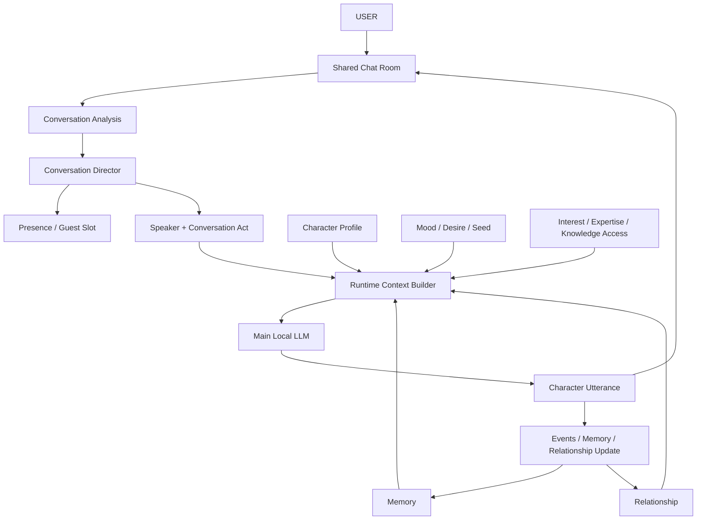

# Local Character Lab

> 複数のキャラクターが同じ部屋で暮らし、それぞれの人格・記憶・関係性・興味・話し方を持ちながら、USERや他キャラクターと自然に会話するローカルLLMベースのCharacter Engine研究開発プロジェクト。

## このプロジェクトで作りたいもの

普通のマルチキャラクターチャットではなく、キャラクターが「今ここにいる」と感じられる会話空間を目指す。

- キャラクターごとにPersonality / Speech Style / Interests / Expertise / Valuesを持つ
- MemoryとKnowledge Accessを分け、知らない出来事を勝手に知ったことにしない
- RelationshipをFamiliarity / Affection / Trust / Comfort / Tensionに分けて扱う
- Mood / Desire / Seed / Life Cycleによって発言・沈黙・入退室が変わる
- Conversation Directorが「誰が話すか」「何の役割で話すか」を決める
- 3人の通常メンバー + 1つのGuest Slotを基本のRoom体験とする
- Main LLMはキャラクターの最終発話と高度な意味理解に集中させる
- ローカルモデルを交換できるModel Libraryを用意する
- 通常foreground会話は10秒以内を目安にする
- 将来的に新躍進政策へCharacter Engineとして統合できる構造にする

## ざっくりした構造



より詳しい図は `docs/ARCHITECTURE_OVERVIEW.md` を参照。

## 現在のモデル方針

初期候補:

```text
PC / laptop
Main: 8B-class
Helper: 0.6B-class

Android 8GB-class
Main: 4B-class
Helper: 0.6B-class

Lightweight Android
Main: 2B-class
```

モデルサイズが変わっても、Memory / Relationship / Character Profileなどの機能は同じCharacter Engine側に残す。違いは主に発話品質・複雑な文脈理解・表現の繊細さとして出る設計にする。

## 現在のステータス

現在はMVP実装前の設計確定フェーズ。会話・人格・関係性・知識・モデル管理・遅延目標の主要方針はかなり固まっている。

次の主な作業:

- MVP Runtime Schema確定
- Android UI skeleton
- Character Profile / Characters一覧
- Conversation Director実装
- Room / Memory / Relationship永続化
- Main / Helper local model runtime接続
- Developer Modeによるscore / latency可視化

## 最初に読むドキュメント

- `docs/PROJECT_OVERVIEW.md` : 何を作るか、なぜ作るか
- `docs/ARCHITECTURE_OVERVIEW.md` : システム全体の図解
- `docs/CHARACTER_SYSTEM.md` : Character Profile
- `docs/SPEECH_STYLE_SYSTEM.md` : キャラクターらしい話し方
- `docs/RELATIONSHIP_SYSTEM.md` : 人間関係
- `docs/MEMORY_SYSTEM.md` : 記憶
- `docs/PRESENCE_SYSTEM.md` : Roomへの入退室
- `docs/KNOWLEDGE_SYSTEM.md` : Interest / Expertise / Knowledge Access
- `docs/CONVERSATION_ACTS.md` : 発言の役割
- `docs/RUNTIME_CALL_BUDGET.md` : LLM call数と10秒目標
- `docs/MODEL_LIBRARY.md` : Download / Use / Delete可能なモデル管理
- `CONTRIBUTING.md` : 共同開発への参加方法

## Repositoryの記録方針

- `docs/` : 現在採用している正式仕様
- `decisions/` : 大きな設計判断と理由
- `notes/` : 設計会議・アイデア出しの履歴
- `characters/` : 将来のCharacter Profile定義

## 共同開発

Android / Kotlin / Compose、ローカルLLM、会話UX、Character Profile設計、テスト、ドキュメント整理など、複数の入り口を想定している。

参加前に `docs/PROJECT_OVERVIEW.md` と `CONTRIBUTING.md` を読むと全体像を掴みやすい。
