# Architecture Overview

このドキュメントは、Local Character Labの全体像を初見の共同開発者が短時間で把握するための図解資料。

## 1. High-level architecture

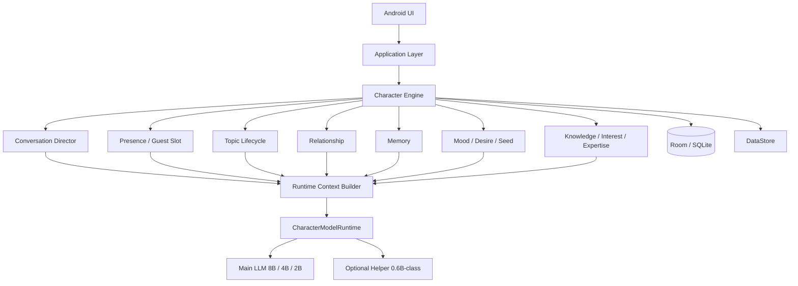

## 2. Conversation flow

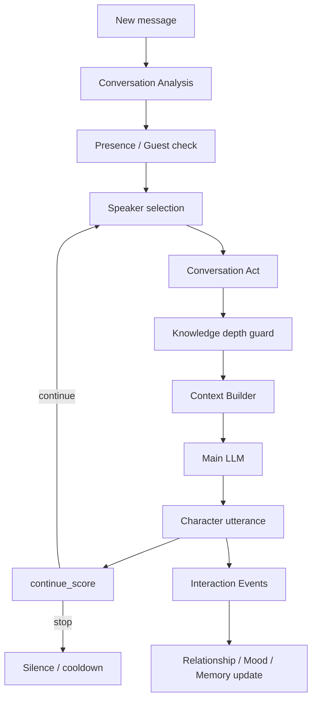

固定ローテーションは使わない。`SILENCE`は正常な出力。

## 3. Character runtime input

Main LLMへCharacterの全DBを投げない。Context Builderが必要部分だけ抽出する。

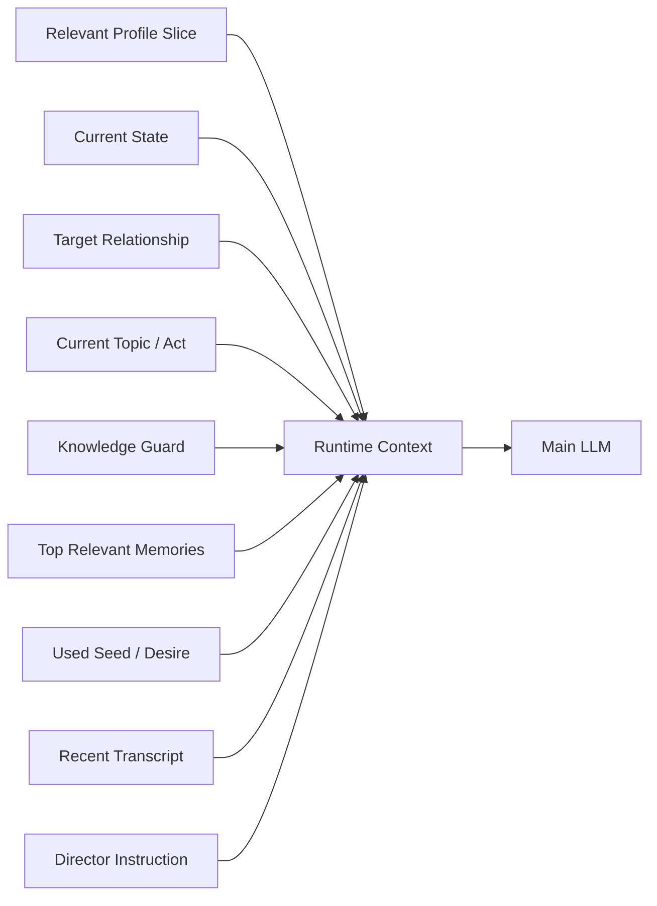

## 4. Character identity

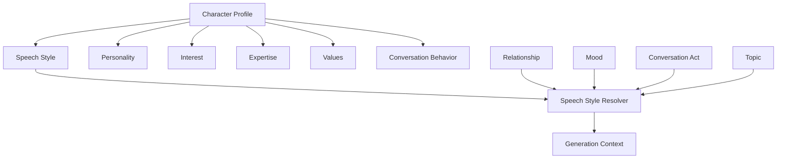

## 5. Social state

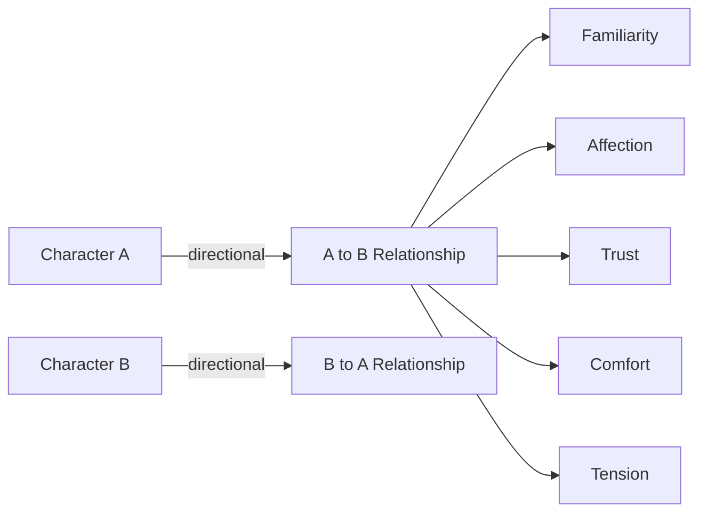

`A -> B` と `B -> A` は独立。

## 6. Knowledge separation

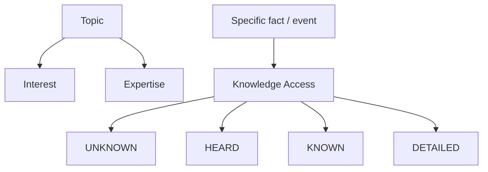

同じ基盤モデルが内部的に知っていることと、Characterが知っていることは分ける。

## 7. Memory to autonomous conversation

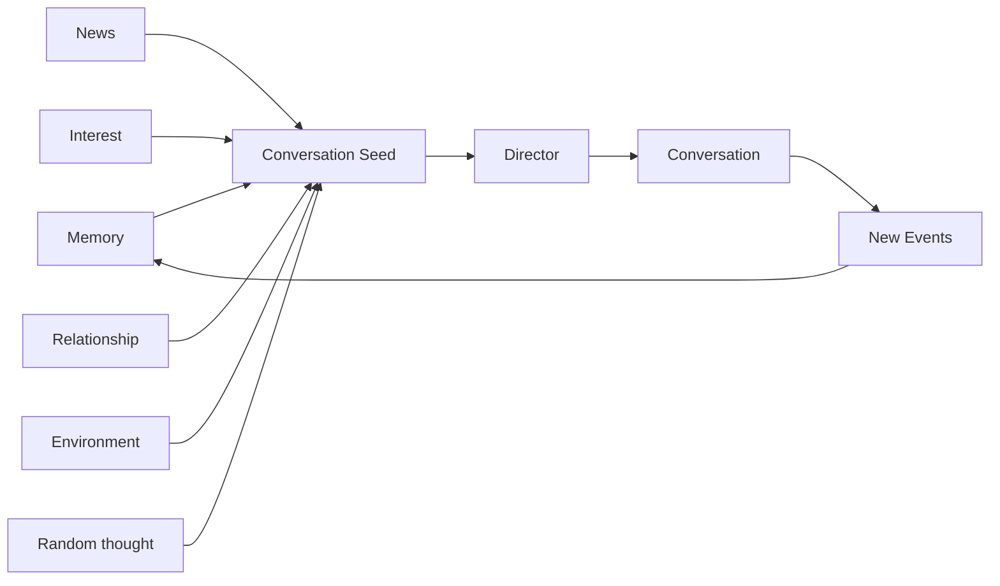

## 8. Character Goal concept

現在は設計候補。GoalはDesireより長い方向性を持つ。

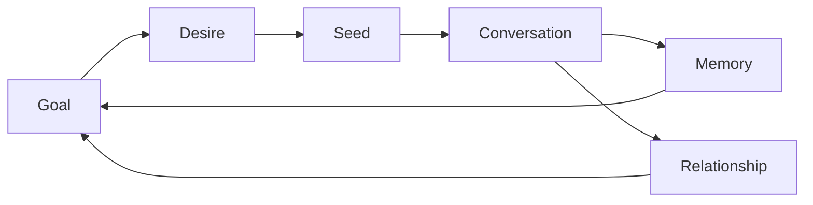

## 9. Model runtime

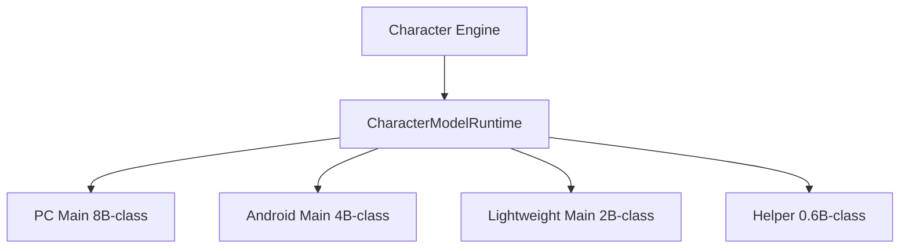

Model Runtimeは交換可能にし、Character Profile / Memory / Relationshipとは分離する。

## 10. Foreground latency budget

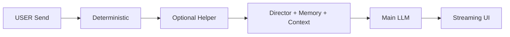

通常foreground turnの目安は10秒以内。Main LLM callは通常1回を第一目標にする。

## 11. Android UI

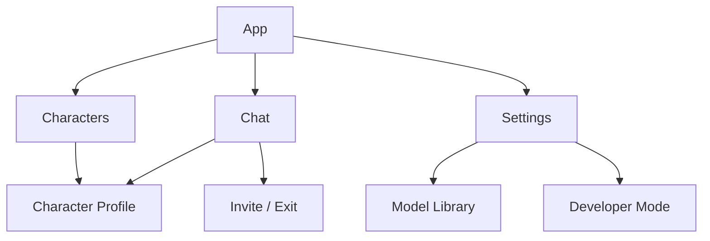

ProfileはChat iconからでもCharacters一覧からでも同じ画面・同じデータを使う。

## 12. Ownership boundaries

```text
UI
  表示・入力・navigation

Application
  use case orchestration

Domain / Character Engine
  world rules / Director / Presence / Relationship / Memory logic

Persistence
  Room / DataStore / repositories

Model Runtime
  Main / Helper inference
```

UIから直接Relationship値やMood値を書き換えない。必ずApplication / Domainを通す。
